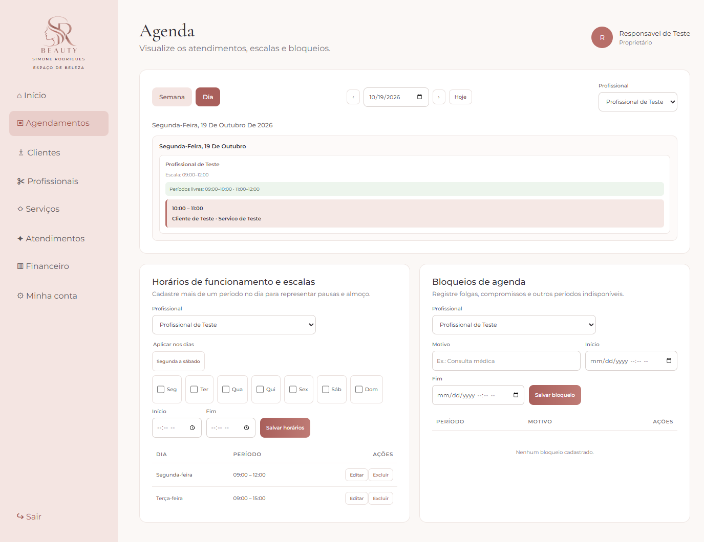
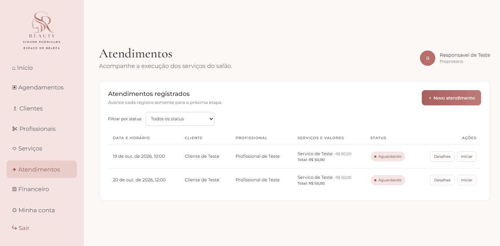
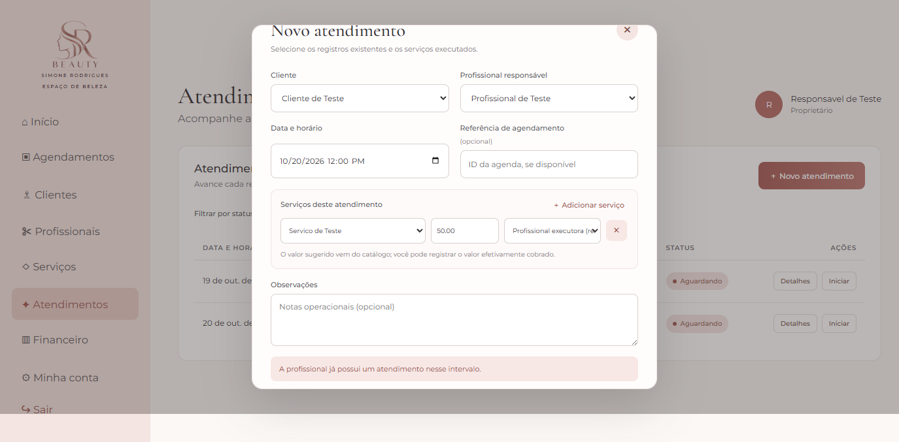

# Registro de Testes de Software

Pré-requisitos: [Projeto de Interface](INSERIR-LINK-DO-PROJETO-DE-INTERFACE) e [Plano de Testes de Software](INSERIR-LINK-DO-PLANO-DE-TESTES)

Os testes funcionais realizados na aplicação web **SR Beauty** são descritos a seguir. Os testes têm como objetivo verificar o funcionamento das principais telas e funcionalidades do sistema, garantindo que os fluxos definidos no projeto estejam funcionando conforme os requisitos estabelecidos.

#

1. CT-1: Verificar o funcionamento do cadastro e login de usuários.

**Objetivo:** Verificar se o usuário consegue realizar seu cadastro e acessar o sistema utilizando suas credenciais.

**Verificações:**
- Preenchimento dos dados obrigatórios;
- Validação dos campos;
- Cadastro de um novo usuário;
- Login com credenciais válidas;
- Impedimento de acesso com credenciais inválidas;
- Direcionamento do usuário para a área correspondente ao seu perfil.
  
**Responsável:** Luiz Guilherme Martins Franchim
**Responsável:** Pâmella Almeida da Silva

**Evidência:**

https://github.com/user-attachments/assets/b83e0691-c6b4-4464-ab34-fedbef6e13b3

<hr>

2. CT-2: Verificar o funcionamento do Dashboard conforme o perfil do usuário.

**Objetivo:** Verificar se o sistema apresenta as informações e funcionalidades correspondentes ao perfil de acesso do usuário.

**Verificações:**
- Exibição correta do Dashboard;
- Visualização das informações principais;
- Acesso às funcionalidades disponíveis;
- Restrição de funcionalidades não permitidas para o perfil;
- Navegação entre os módulos do sistema.

**Responsável:** [Nome do integrante]

**Evidência:**

[Inserir imagem ou vídeo do teste]

<hr>

3. CT-3: Verificar o funcionamento da consulta de disponibilidade e agenda dos profissionais.

**Objetivo:** Verificar se o usuário consegue consultar corretamente os horários disponíveis dos profissionais.

**Verificações:**
- Seleção da data;
- Seleção do profissional;
- Exibição dos horários disponíveis;
- Identificação dos horários já ocupados;
- Exibição correta da agenda conforme o período selecionado.

**Responsável:** Júlio César Villaça (teste realizado para Virgílio Zenith)

**Evidências da execução funcional na interface (base SQLite temporária e isolada):**

Na agenda diária de **19/10/2026**, foi selecionada a profissional de teste. A escala cadastrada era **09:00–12:00**; a tela apresentou os períodos livres **09:00–10:00** e **11:00–12:00**, e identificou o atendimento ocupado entre **10:00–11:00**.



**Verificações automatizadas:** consulta diária e semanal para o período selecionado; horários livres calculados em torno do atendimento; dia sem escala (nenhum período livre); escala completamente ocupada (nenhum período livre); data inválida (HTTP 400). Resultado: aprovado.

**Resultado do CT-3: Aprovado.** A execução foi feita na interface web usando dados sintéticos em uma base SQLite isolada; não foram alterados dados reais ou a base de desenvolvimento.

<hr>

4. CT-4: Verificar o funcionamento do agendamento de atendimento.

**Objetivo:** Verificar se o usuário consegue realizar um agendamento selecionando profissional, serviço, data e horário disponíveis.

**Verificações:**
- Seleção do profissional;
- Seleção do serviço;
- Seleção da data;
- Seleção de horário disponível;
- Confirmação do agendamento;
- Exibição do agendamento na agenda.

**Responsável:** Virgílio Zenith

**Evidência:**


<hr>

5. CT-5: Verificar o bloqueio de conflito de horários no agendamento.

**Objetivo:** Verificar se o sistema impede que dois atendimentos sejam agendados para o mesmo profissional no mesmo horário.

**Verificações:**
- Realização de um primeiro agendamento;
- Tentativa de realizar outro agendamento para o mesmo profissional e horário;
- Apresentação de mensagem de conflito;
- Impedimento da confirmação do segundo agendamento;
- Manutenção do primeiro agendamento.

**Responsável:** Júlio César Villaça (teste realizado para Virgílio Zenith)

**Evidências da execução funcional na interface (base SQLite temporária e isolada):**

Foi criado pela interface um primeiro atendimento válido para **20/10/2026 às 12:00**, com a profissional e o serviço de teste. A tentativa de registrar outro atendimento para a mesma profissional, data, horário e serviço foi recusada; a interface exibiu **“A profissional já possui um atendimento nesse intervalo.”** (resposta HTTP 409). Após fechar o formulário, o primeiro registro continuou na lista. A contagem de linhas e a consulta a `GET /api/atendimentos` permaneceram em **2 registros** (um registro de demonstração do CT-3 e o primeiro atendimento do CT-5); o duplicado não foi persistido.

**Primeiro atendimento válido, antes da tentativa duplicada:**



**Conflito apresentado pela interface ao tentar repetir o horário:**



**Lista após fechar o formulário: primeiro atendimento mantido e duplicado ausente:**


**Verificações automatizadas:** rejeição do mesmo horário inclusive com offset equivalente; rejeição de sobreposição parcial de 30 minutos para serviço de 60 minutos; aceitação de horário adjacente exatamente ao fim do primeiro atendimento; confirmação de que somente o primeiro e o adjacente foram salvos. Resultado: aprovado.

**Concorrência:** a criação bloqueia os registros da profissional antes de consultar disponibilidade (bloqueio de escrita no SQLite e `FOR UPDATE` nos demais bancos suportados). Foi revisada essa proteção existente, mas não foi executado teste simultâneo de concorrência.

**Resultado do CT-5: Aprovado** para o fluxo sequencial de conflito testado na interface e no backend. Os testes não constituem uma medição concorrente.

<hr>

6. CT-6: Verificar o funcionamento do registro de atendimento realizado.

**Objetivo:** Verificar se o profissional consegue registrar corretamente um atendimento realizado.

**Verificações:**
- Seleção do cliente;
- Seleção do profissional;
- Seleção do serviço;
- Registro do valor;
- Registro da data do atendimento;
- Confirmação do atendimento realizado;
- Atualização do status do agendamento.

**Responsável:** Virgílio Zenith 

**Evidência:**


<hr>

7. CT-7: Verificar o funcionamento do registro da forma de pagamento e taxa da máquina de cartão.

**Objetivo:** Verificar se o sistema permite registrar corretamente a forma de pagamento utilizada no atendimento e a taxa da máquina quando o pagamento for realizado por cartão.

**Verificações:**
- Seleção de pagamento em Pix;
- Seleção de pagamento em dinheiro;
- Seleção de pagamento em cartão;
- Exibição do campo de taxa da máquina quando aplicável;
- Registro do valor da taxa;
- Salvamento das informações do atendimento.

**Responsável:** [Nome do integrante]

**Evidência:**

[Inserir imagem ou vídeo do teste]

<hr>

8. CT-8: Verificar o cálculo do repasse conforme o tipo de serviço.

**Objetivo:** Verificar se o sistema calcula corretamente o valor do repasse utilizando o percentual definido para o tipo de serviço.

**Verificações:**
- Seleção do serviço;
- Identificação do percentual correspondente ao serviço;
- Cálculo automático do valor do repasse;
- Exibição do valor destinado ao profissional;
- Exibição do valor destinado ao salão;
- Conferência dos valores calculados.

**Responsável:** Flávia Sergina Rodrigues

**Evidência 1:**


**Evidência 2:**


**Evidência 3:**


**Evidência 4:**


<hr>

9. CT-9: Verificar o registro do pagamento do repasse ao salão.

**Objetivo:** Verificar se o sistema permite controlar o status do repasse realizado pelo profissional ao salão.

**Verificações:**
- Visualização dos repasses pendentes;
- Identificação do profissional;
- Identificação do atendimento;
- Exibição do valor do repasse;
- Alteração do status para pago;
- Atualização do registro após a confirmação do pagamento.

**Responsável:** Flávia Sergina Rodrigues

**Evidência 1:**


**Evidência 2:**


**Evidência 3:**


<hr>

10. CT-10: Verificar o funcionamento do cadastro e controle de despesas.

**Objetivo:** Verificar se a proprietária consegue registrar e consultar as despesas do salão.

**Verificações:**
- Registro de aluguel;
- Registro de água;
- Registro de energia;
- Registro de internet;
- Registro de materiais de uso e consumo;
- Registro de outras despesas;
- Informações de valor e data;
- Salvamento e consulta das despesas cadastradas.

**Responsável:** [Nome do integrante]

**Evidência:**

[Inserir imagem ou vídeo do teste]

<hr>

11. CT-11: Verificar o funcionamento do fechamento financeiro semanal.

**Objetivo:** Verificar se o sistema consolida corretamente as informações financeiras referentes ao período semanal selecionado.

**Verificações:**
- Seleção do período;
- Consulta das receitas;
- Consulta das despesas;
- Consulta dos repasses;
- Cálculo do total de entradas;
- Cálculo do total de saídas;
- Apresentação do resultado financeiro do período.

**Responsável:** [Nome do integrante]

**Evidência:**

[Inserir imagem ou vídeo do teste]

<hr>

12. CT-12: Verificar o funcionamento do relatório financeiro mensal.

**Objetivo:** Verificar se o sistema apresenta corretamente as informações financeiras consolidadas do mês selecionado.

**Verificações:**
- Seleção do mês;
- Receita total;
- Total de despesas;
- Valores recebidos;
- Valores de repasses;
- Repasses pagos e pendentes;
- Resultado financeiro mensal;
- Conferência dos valores apresentados.

**Responsável:** [Nome do integrante]

**Evidência:**

[Inserir imagem ou vídeo do teste]

<hr>

13. CT-13: Verificar o funcionamento do cadastro de profissionais.

**Objetivo:** Verificar se a proprietária consegue cadastrar e consultar as profissionais que trabalham no salão.

**Verificações:**
- Preenchimento dos dados da profissional;
- Validação dos campos obrigatórios;
- Salvamento do cadastro;
- Consulta da profissional cadastrada;
- Alteração das informações;
- Ativação ou desativação da profissional, quando aplicável.

**Responsável:** [Nome do integrante]

**Evidência:**

[Inserir imagem ou vídeo do teste]

<hr>

14. CT-14: Verificar o funcionamento do cadastro de serviços e percentuais de repasse.

**Objetivo:** Verificar se a proprietária consegue cadastrar os serviços oferecidos pelo salão e definir o percentual de repasse correspondente a cada tipo de serviço.

**Verificações:**
- Cadastro de um novo serviço;
- Registro do valor do serviço;
- Definição do percentual de repasse;
- Salvamento das informações;
- Consulta do serviço cadastrado;
- Alteração das informações;
- Utilização do percentual cadastrado no cálculo do repasse.

**Responsável:** [Nome do integrante]

**Evidência:**

[Inserir imagem ou vídeo do teste]

<hr>

15. CT-15: Verificar a integração entre os módulos do sistema.

**Objetivo:** Verificar se as informações registradas em um módulo são corretamente utilizadas pelos demais módulos relacionados.

**Verificações:**
- Realização de um agendamento;
- Registro do atendimento realizado;
- Registro do pagamento;
- Cálculo do repasse;
- Atualização das informações financeiras;
- Inclusão dos valores no fechamento semanal;
- Inclusão dos valores no relatório mensal.

**Responsável:** [Nome do integrante]

**Evidência:**

[Inserir imagem ou vídeo do teste]

<hr>

## Resultado dos testes

Após a execução dos casos de teste, os resultados deverão ser registrados pela equipe, identificando se cada caso foi **Aprovado** ou **Reprovado**. Para os casos reprovados, deverão ser registradas as inconsistências encontradas e, após a correção, o teste deverá ser executado novamente.

| Caso de Teste | Resultado | Observação |
|---|---|---|
| CT-1 | Aprovado | Cadastro e login realizados com sucesso, conforme comportamento esperado. |
| CT-2 | [Aprovado/Reprovado] | [Observação] |
| CT-3 | Aprovado | Interface e testes automatizados confirmaram escala, períodos livres, período ocupado, dia sem escala, escala totalmente ocupada e rejeição de data inválida. Evidência em `evidencias/CT-3-agenda.png`. |
| CT-4 | [Aprovado/Reprovado] | [Observação] |
| CT-5 | Aprovado | Interface rejeitou duplicidade com HTTP 409 e manteve o primeiro registro; testes automatizados confirmaram sobreposição rejeitada e horário adjacente aceito. Concorrência simultânea não foi testada. Evidências em `evidencias/CT-5-*.png`. |
| CT-6 | [Aprovado/Reprovado] | [Observação] |
| CT-7 | [Aprovado/Reprovado] | [Observação] |
| CT-8 | Aprovado | Registro de repasse realizado com sucesso |
| CT-9 | Aprovado | Confirmação de pagamento de repasses executado com sucesso |
| CT-10 | [Aprovado/Reprovado] | [Observação] |
| CT-11 | [Aprovado/Reprovado] | [Observação] |
| CT-12 | [Aprovado/Reprovado] | [Observação] |
| CT-13 | [Aprovado/Reprovado] | [Observação] |
| CT-14 | [Aprovado/Reprovado] | [Observação] |
| CT-15 | [Aprovado/Reprovado] | [Observação] |

## Execução automatizada registrada para CT-3 e CT-5

Comando dos testes direcionados:

```powershell
python -m unittest tests.test_agenda_api.AgendaApiTestCase.test_daily_and_weekly_agenda_reports_available_periods_and_occupied_hours tests.test_agenda_api.AgendaApiTestCase.test_agenda_reports_no_free_period_when_shift_is_fully_occupied tests.test_agenda_api.AgendaApiTestCase.test_appointment_rejects_overlapping_duration_and_accepts_adjacent_slot -v
```

Resultado: **3 testes passaram**.

Comando da suíte completa:

```powershell
python -m unittest discover -s tests -v
```

Resultado final: **16 testes passaram**. Na primeira execução após a alteração dos testes, uma asserção esperava a palavra “conflito”, diferente da mensagem efetiva da API (“A profissional já possui um atendimento nesse intervalo.”); a expectativa do teste foi alinhada à mensagem existente e as execuções direcionada e completa seguintes passaram. Não foi salvo arquivo de log bruto; os resultados e as capturas reais da interface estão registrados neste documento e nos PNGs acima.
